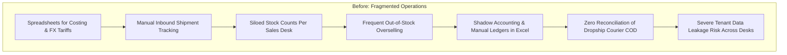
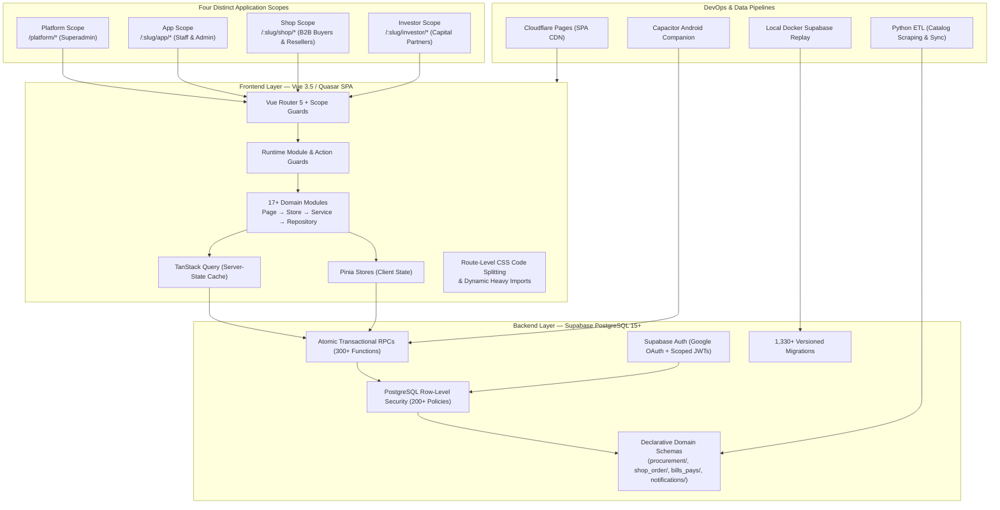
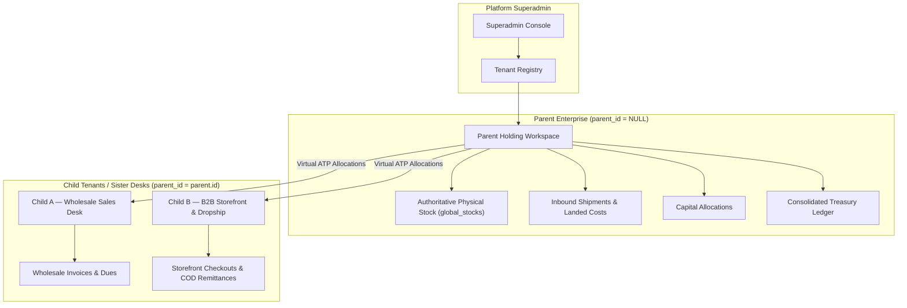
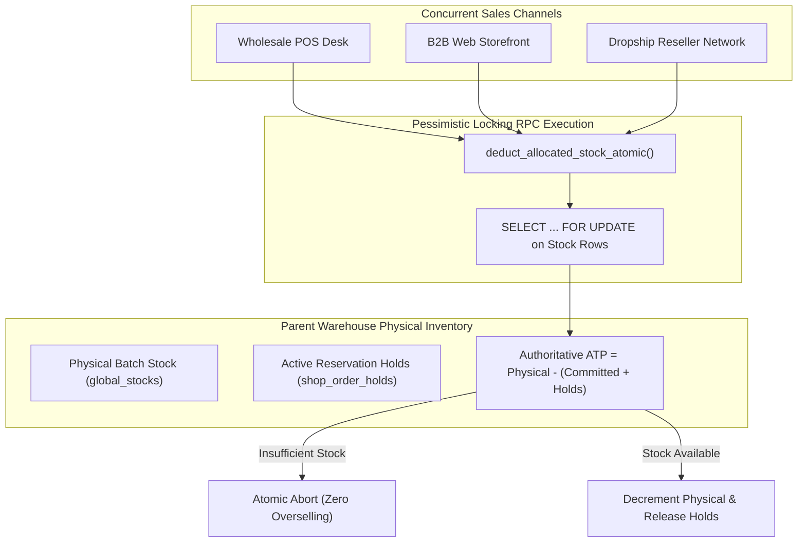
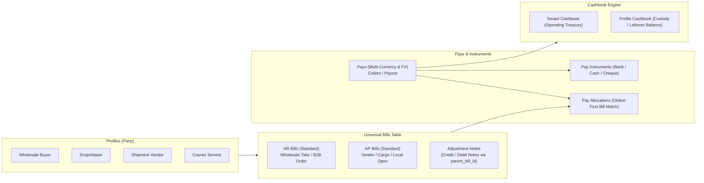
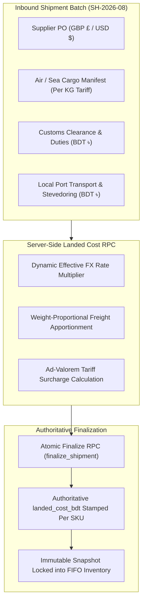
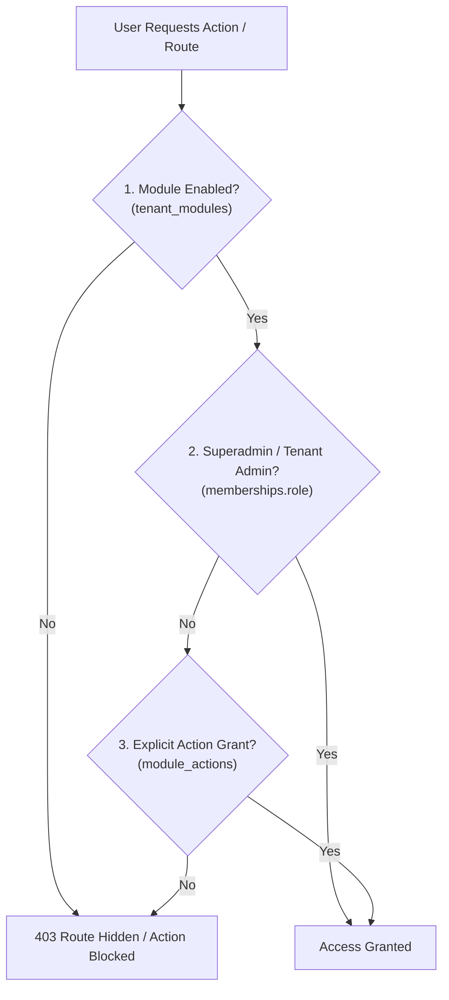
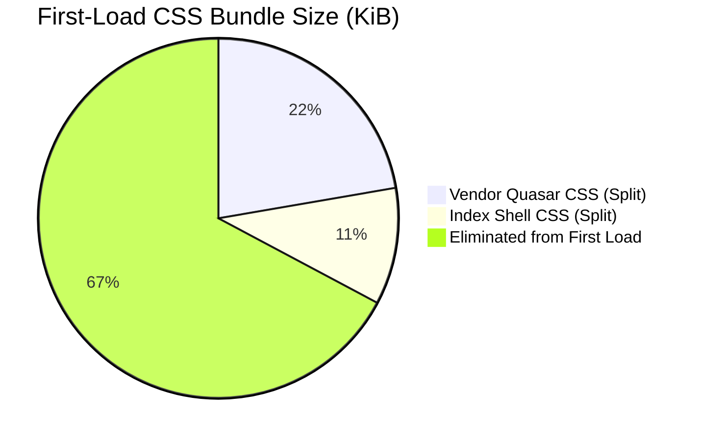
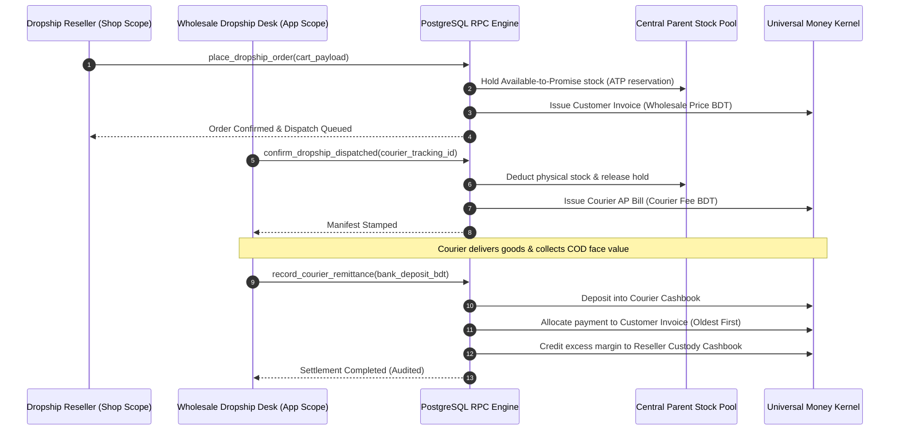
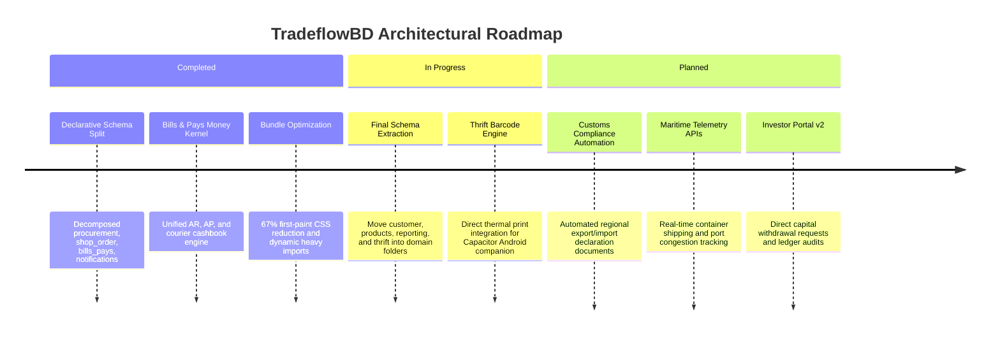

## At a Glance

| | |
|---|---|
| **What it is** | Multi-tenant enterprise wholesale ERP and commerce platform |
| **Who it's for** | Import/wholesale conglomerates with parent companies, child sales desks, and sister concerns |
| **Core problem** | Run procurement, stock, wholesale sales, B2B storefronts, dropship networks, and multi-currency treasury in one system — with zero overselling and 100% database-enforced tenant data isolation |
| **How it's built** | Vue 3.5 / Quasar 2 SPA → Supabase PostgreSQL 15+ with declarative domain schemas, 200+ RLS policies, and 300+ atomic RPCs |
| **Scale** | 17+ domain modules · 1,330+ migrations · 470+ Vue components · 4 application scopes · 4 business models |

---

## The Problem

Wholesale import businesses in Bangladesh and emerging trade hubs operate across complex, distributed legal and commercial boundaries:

- A **parent company** manages international supplier procurement, maritime freight, customs clearance, and central warehouse stock.
- **Sister concerns (child tenants)** operate independent wholesale sales desks, branded B2B storefronts, and dropship reseller networks.
- **External investors** fund high-capital shipment batches and require real-time yield visibility without accessing operational tenant data.
- **B2B customers** purchase through branded storefronts, carry credit limits, and require instant invoice reconciliation.

### Operational Friction Prior to TradeflowBD



| Operational Friction | Business & Technical Consequence |
|---|---|
| **No Centralized Stock Pool** | Same physical inventory counted independently per sister concern — leading to catastrophic overselling and multi-week stock reconciliation disputes. |
| **Pricing Guesswork** | International freight, customs duties, and fluctuating FX rates calculated in static spreadsheets; unit landed costs were inaccurate, causing margin bleed. |
| **Tenant Data Leakage** | Competing sales desks operated on shared servers; application-level filtering (`WHERE tenant_id = ?`) frequently leaked client lists, margin sheets, and sales volume. |
| **Unreconciled Cash & COD** | Courier cash-on-delivery remittances, dropshipper commission payouts, and wholesale dues were managed in disconnected ledgers with zero audit trail. |
| **Monolithic Code & SQL Drift** | 10,000+ lines of unstructured SQL migrations created deploy paralysis, regression bugs, and schema divergence between local and production databases. |

---

## System Architecture & Domain Scope

TradeflowBD is architected as a **unified multi-tenant commerce engine** supporting four co-existing business models, four distinct user application scopes, and a strict parent–child data isolation boundary.



### 1. Four Application Scopes (Surfaces)

Rather than maintaining separate web repositories, the entire ecosystem runs from a single unified codebase partitioned into four distinct application surfaces:

| Scope | Entry Route | Target Persona | Architectural Capabilities |
| :--- | :--- | :--- | :--- |
| **`platform`** | `/auth/platform/login` → `/platform/*` | Superadmin | Multi-tenant provisioning, module catalog activation, global reference data, platform telemetry. |
| **`app`** | `/:slug/app/*` | Tenant Admin & Staff | Complete wholesale ERP backoffice: procurement, ATP inventory, bills & payments desk, costing, and reports. |
| **`shop`** | `/:slug/shop/*` (or custom host) | B2B Buyers & Resellers | High-performance storefront: wholesale catalog browsing, customer cart, dropship ordering, and order tracking. |
| **`investor`** | `/:slug/investor/*` | Capital Partners | Strictly read-only yield statements, shipment batch profitability, and financial performance audits (zero withdrawal access). |

### 2. Multi-Tenant Parent–Child Hierarchy

The multi-tenant isolation model is strictly **one level deep**:



- **Physical Stock Ownership:** Physical warehouse inventory rows (`global_stocks`) exist strictly on the parent entity. Child sales desks consume real-time virtual slices via `global_stock_allocations`.
- **Inbound Shipments:** Managed and owned exclusively at the parent tier.
- **Billing & Commerce:** Child sales desks generate `bills` stamped with their `issued_by_tenant_id` for customer-facing branding, while settlement rolls into the parent consolidated ledger.
- **Hierarchy Boundary:** A child tenant cannot spawn sub-tenants; a parent with active children cannot be nested.

### 3. Four Co-existing Business Models

TradeflowBD is architected to support four distinct commercial modalities within a single tenant configuration without table cross-contamination:

```text
Pre-Order (PBC / Catalog Negotiation)
        ↓ demand aggregation & purchase order
Parent Warehouse (global_stocks) → Wholesale Invoice / Stock-Backed Shop / Dropship

K-beauty (koba_*)     ← Isolated UK/Korean catalog, retail carts & commission engine
Thrift (thrift_*)     ← Isolated one-off garment intake, barcode tagging & POS
```

1. **Brandwala Wholesale (BW):** The flagship in-hand inventory model. Goods land in parent warehouse `global_stocks`, receive landed cost stamps, and are sold via wholesale invoices (`bills`), stock-backed shops, and dropship channels.
2. **Pre-Order (Product-Based Costing / PBC):** Quotes generated before goods land. Backlog auto-suggestions (`costingFile`) aggregate customer demand before international purchase orders are cut.
3. **K-beauty (Koba):** Dedicated UK/Korean cosmetics catalog with dedicated tables (`koba_products`, `koba_orders`, `koba_carts`). Operates an isolated profit-share and commission engine without contaminating wholesale FIFO stock.
4. **Thrift:** Second-hand garment vertical with individual garment intake boxes, unique SKU thermal barcodes, physical condition grading, dedicated thrift POS, and courier COD reconciliation.

---

## Core Engineering Innovations

```
+----------------------------------------------------------------------------------------------------+
|  [Logo] TradeflowBD  |  [Scope: Parent Corp v]  |  [Global Search Ctrl+K]  |  [FX: ৳170]  | (Avatar) |
+----------------------+-----------------------------------------------------------------------------+
| NAVIGATION           | BREADCRUMB: Wholesale > Procurement > Inbound Shipments > Batch #SH-2026-08 |
|                      +-----------------------------------------------------------------------------+
| [=] Dashboard        | +-- BATCH KPI HEADER -----------------------------------------------------+ |
| [T] Tenants & Desks  | | Port of Origin: Felixstowe, UK   | Containers: 4x 40ft HQ   | Status: IN_TRANSIT| |
| [!] Access Control   | | Total CBM: 142.5 m³             | Net Weight: 18,420 kg    | Landed: ৳8.45M    | |
| [?] Help Center      | +-------------------------------------------------------------------------+ |
| [@] Customers        |                                                                             |
| [#] Invoices (POS)   | +-- ACTION TOOLBAR -------------------------------------------------------+ |
| [>] Procurement      | | [+ Add Items] [Apportion Landed Costs] [Print Thermal Tags] [v Export]   | |
| [*] Product Costing  | +-------------------------------------------------------------------------+ |
| [$] Shop & Dropship  |                                                                             |
| [&] Bills & Pays     | +-- REAL-TIME PRODUCT APPORTIONMENT TABLE --------------------------------+ |
|                      | | [x] | SKU Code     | Product Name         | Qty  | Unit(£) | Landed(৳) | Margin% | |
|                      | |-----|--------------|----------------------|------|---------|-----------|---------| |
|                      | | [ ] | TOALP001     | Alpecin Shampoo C1   | 1200 | £4.75   | ৳1,280.00 | 18.5%   | |
|                      | | [ ] | TOAQU133A    | Aquafresh Toothpaste | 3500 | £0.75   | ৳380.00   | 14.2%   | |
|                      | | [ ] | TONXT-JKT    | Next Corduroy Jacket | 450  | £12.00  | ৳2,850.00 | 32.0%   | |
|                      | +-------------------------------------------------------------------------+ |
| [<-] Sign Out        | PAGE 1 OF 18 (240 ITEMS)                      [<<] [<] [1] [2] [3] [>] [>>] |
+----------------------+-----------------------------------------------------------------------------+
```

### 1. Parent-Pooled Available-to-Promise (ATP) Stock Allocation

To eliminate the classic multi-desk overselling problem, physical inventory is centralized in parent `global_stocks` while child desks receive virtual allocation slices.



- When a buyer adds a product to a cart or places an order on a child storefront, an atomic RPC calculates real-time Available-to-Promise (ATP) inventory: `ATP = Quantity Physical - (Quantity Committed + Quantity Held)`.
- Concurrent checkouts acquire a pessimistic row lock (`SELECT FOR UPDATE`) on the target stock slice. If ATP is depleted, the transaction immediately rolls back with an authoritative `INSUFFICIENT_STOCK` error code.

### 2. The Unified Bills & Pays Money Kernel

The platform refactored fragmented, ad-hoc wallet tables into a unified **Money Kernel**:

```text
Layers: Profile → Bill → Pay → Allocation → Cashbook
```



- **Polymorphic Bills Engine:** A single `bills` table manages both Accounts Receivable (wholesale sales, condition sales, storefront orders) and Accounts Payable (inbound shipment vendor costs, cargo freight, and local port opex).
- **Immutable Financial Audit Trail:** Issued bills can never be quietly mutated. If quantities or prices change post-issuance, the system mandates a `credit_note` or `debit_note` referencing the `parent_bill_id`.
- **Dropship Remittance Mechanics:**
  1. Customer invoice issued to dropshipper at wholesale price upon dispatch.
  2. Courier collects retail cash-on-delivery (COD) face value into courier cashbook.
  3. Upon delivery, courier remits net bank deposit.
  4. System allocates remittance to settle supplier wholesale invoice; excess margin is deposited directly into the dropshipper's **Custody Cashbook** for later payout.

### 3. Deterministic Landed Cost Apportionment Engine

Authoritative unit landed costs are stamped directly onto inventory rows at shipment finalization, ensuring downstream invoices, FIFO COGS, and investor yields never rely on estimations:



$$\text{Landed Cost (BDT)} = (\text{Foreign Unit Price} \times \text{Effective FX}) + \left(\frac{\text{SKU Weight}}{\text{Total Batch Weight}} \times \text{Cargo Charges}\right) + \text{Apportioned Duty}$$

- **Dual-Phase Design:** Real-time in-memory calculation previews unit landed costs and estimated gross margins in the UI. When the shipment is marked received, an atomic `SECURITY DEFINER` RPC writes the authoritative `landed_cost_bdt` snapshot onto shipment items.
- **Outcome Variance Tracking:** Quantities received with physical defects, commercial shortages, or customs seizures are recorded as outcome adjustments, ensuring stock records reflect true physical reality.

### 4. Three-Layer Runtime Module & Permission Guard

Features are dynamically enabled per tenant without deploying bespoke code binaries:



- **Action Grant Hierarchy:** Granular action grants (`view`, `create`, `edit`, `delete`, `manage`, `order`) evaluated at both the UI router navigation guard and database RLS engine via `membership_has_module_action()`.

---

## Database Design & Concurrency

### Declarative Modular Schema Split

To eliminate risk across 1,330+ migrations, the monolithic database schema was decomposed into declarative domain modules in `supabase/schemas/<domain>/`:

```
supabase/schemas/
├── _extensions.sql                  # Extensions (uuid-ossp, pgcrypto)
├── public.sql                       # Master declarative public schema (unsplit domains)
├── procurement/                     # SPLIT: Shipments, items, suppliers, purchase tracking
│   ├── 01_types.sql                 # Custom enums and composite domain types
│   ├── 02_tables.sql                # Table DDL, defaults, constraints, foreign keys, indexes
│   ├── 03_rpcs.sql                  # Stored procedures & atomic business logic
│   └── 04_rls.sql                   # Row Level Security engine policies
├── shop_order/                      # SPLIT: Shops, carts, listings, orders, dropship settlement
├── bills_pays/                      # SPLIT: Bills, lines, pays, instruments, cashbook, profiles
└── notifications/                   # SPLIT: Inbox, preferences, push subscriptions
```

### Local-First Docker Replay & Schema Diff Verification

Production data and schema migrations are safeguarded through a strict local verification workflow:

1. **Declarative Modification:** Developers edit SQL definitions directly in `supabase/schemas/<domain>/`.
2. **Schema Diffing:** Running `pnpm run backend:schema:diff` invokes `supabase db diff` to detect declarative changes and generate timestamped migration scripts.
3. **Clean Container Replay:** Running `pnpm run backend:reset` spins up a local Docker Supabase instance, wipes the database, and replays all **1,330+ migrations** sequentially.
4. **Automated Type Generation:** Running `pnpm run backend:types:local` emits fresh TypeScript contracts to `web/src/types/database.types.ts`.

---

## Performance Benchmarks & Reliability

During the Q4 2026 performance optimization initiative, the application underwent rigorous bundle profiling, route code splitting, and database query analysis.

### Frontend Optimization Program (Phase 1 & Phase 2 Results)



| Metric | Before Optimization | After Optimization | Engineering Improvement |
| :--- | :--- | :--- | :--- |
| **First-Load CSS Bundle** | **857 KiB** (1 monolithic bundle) | **281 KiB** (vendor-quasar 191 + index 90) | **67% reduction** via `cssCodeSplit: true` across 199 route chunks |
| **Material Icons Web Font** | Shipped entire TTF font (~1.8 MB) | Removed completely | Replaced with `@phosphor-icons/web` tree-shaken SVG icons |
| **Diagramming Libraries** | Synchronous app import (1.4 MiB) | Dynamic on-demand import | Mermaid & Elk loaded strictly on developer documentation routes |
| **Excel Export Engine** | Synchronous app import (908 KiB) | Dynamic lazy import | ExcelJS loaded only when user triggers `.xlsx` export |
| **Push Notification Client** | Preloaded on app boot | Lazy chunk (~47 KiB) | Firebase FCM isolated to notification preferences page |
| **Scraped Static JSON** | 10+ MB in `web/public` | Extracted out of bundle | Relocated to Python ETL data storage (`python/data/uk/out`) |

### Database & Server-State Performance

- **Zero Slow App Queries:** Query pooler profiling confirmed zero user-facing SQL queries in the top 10 slowest database calls.
- **TanStack Query State Orchestration:** Integrated `@tanstack/vue-query` with declarative query key factories and optimistic mutation rollbacks. Complex cart mutations and shipment landed cost adjustments reflect instantaneously without full-dataset invalidations.
- **Pessimistic Concurrency:** High-concurrency checkout paths protected via row-level locks on stock rows, maintaining zero overselling across high-volume promotional sales events.

---

## Lessons Learned & Architectural Retrospective

| Architectural Decision | What Worked Well | What Was Refactored / Learned |
| :--- | :--- | :--- |
| **PostgreSQL RLS as Security Boundary** | Evaluating permissions at the database engine eliminated cross-tenant data leaks completely. Frontend bugs could never expose another tenant's confidential margins. | Policy recursion must be carefully controlled; complex subqueries in RLS policies can cause query planner degradation if not indexed properly. |
| **From Ad-Hoc Wallets to Money Kernel** | Moving to the unified Profile · Bill · Pay · Alloc · Cashbook model eliminated shadow Excel ledgers and unified AR, AP, and courier COD reconciliation into one schema. | Financial document updates must always use explicit credit/debit notes (`parent_bill_id`) rather than mutating issued invoices in place. |
| **Declarative Schema Split** | Decomposing `public.sql` into domain folders (`procurement/`, `bills_pays/`, etc.) enabled clean local Docker migration validation and dramatically faster code reviews. | Schema extraction requires automated diff tooling (`supabase db diff`) to ensure declarative files never drift from historical migration scripts. |
| **Server-State vs Client Store Separation** | Using TanStack Query for remote database state while reserving Pinia strictly for transient UI state eliminated cache synchronization bugs. | Optimistic updates on complex financial grids require bulletproof rollback handlers in case server-side RPC validation fails. |

---

## Visual Workflows & Architecture Wireframes

### Dropship Finance Hub — End-to-End Settlement Sequence



### Production Interface Showcase

#### 1. Executive Operations & Live Liquidity Dashboard
Centralized dashboard tracking multi-tenant liquid cash, gross billed turnover, active inbound consignments, real-time inventory assets (৳1.69M, 1,871 units), and courier COD remittances (Steadfast & Pathao).


#### 2. Inbound Shipment Finalization & Landed Costing Breakdown
Procurement batch inspection (`Shiplu Shipment 24`) displaying foreign invoice price (£), unit weights, package weights, duty calculations, and locked unit landed cost (BDT) stamped prior to warehouse intake.


#### 3. B2B Storefront & Multi-Currency Product Catalog Configuration
Administrative product and storefront configuration desk displaying real-time available stock, vendor references, international list pricing (£), and customer group access rules.


#### 4. Dropship Dispatch Dossier & Settlement Ledger
Settlement ledger for dropship dispatch (`ORD-20261008-00860`) itemizing end-customer COD collection (৳8,900.00), packaging & print charge deductions, wholesale dossier cost (৳7,851.00), and automated estimated profit split (৳1,049.00).


#### 5. Mobile Wholesale Storefront (Shop Scope)
B2B buyer ordering experience optimized for mobile screens, featuring direct step-quantity pickers, rapid cart mutations, and bottom tab navigation for catalog, cart, and order tracking.


---

## Future Roadmap


