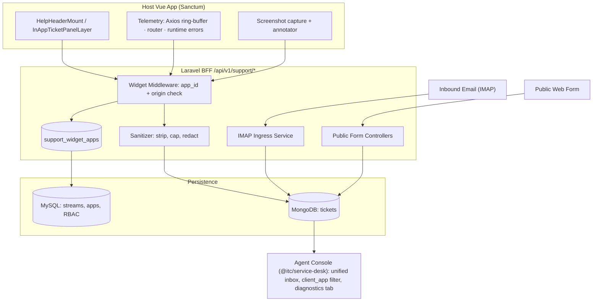

## System Architecture & Domain Scope

**Service Desk** is a diagnostics-first, multi-tenant support platform I built solo at Proficient Information Systems. The CEO and company architect set the technical direction (IMAP ingestion, Knockout.js for the visitor surface, the channel model, and product expectations); I planned the work, verified requirements with the client, and implemented and shipped the product. It turns the support inbox into a command center for a portfolio of Vue/Quasar apps, with three intake channels feeding one agent workspace.

### Distribution Model

- **NPM packages:** the agent console, in-app widget and shared composables ship as reusable components (`@itc/service-desk`), published through the company's internal NPM system.
- **Suite integration:** the packages plug into the company suite, so host apps gain support intake by installing the package and registering an `app_id`.
- **Standalone web app:** a separate deployment of the same packages for use outside the suite.

| Channel | Ingress | Tag | Stream resolution |
|---|---|---|---|
| In-App Vue Widget | `POST /api/v1/support/me/tickets` (Sanctum session) | `in_app` | `app_id` → `support_widget_apps` → `support_stream_id` |
| Email | Async IMAP polling → `SupportEmailIngressService` | `email` | Mailbox configuration |
| Public Web Form | Server-rendered hosted form | `form` | Form configuration |



Frontend follows a modular composable architecture (11 authenticated routes under `/service-desk/*`) with scoped state that resets on tenant switch. The agent console exposes four workbenches: triage inbox, stream queues, form builder and email templates, plus the V1 apps registry.

### Persona Value Map

| Persona | Pains removed | Shipped | Roadmap |
|---|---|---|---|
| **End Reporter** | Manual context entry, separate login, no ticket visibility | Auto context capture, screenshot crop and annotation, Sanctum session, My Tickets | Blur redaction, data opt-out tray, reply-by-email (MVP 3) |
| **Host Developer** | Rebuilding intake per app, `.env` sprawl, seat costs, PII leaks | `@itc/service-desk` components, app registry, unlimited reporters, server-side redaction | None |
| **Support Agent** | "Cannot reproduce" loops, multi-app switching, repetitive replies | Diagnostics tab, unified inbox with `client_app` filter, canned responses and templates | Duplicate detection (MVP 3), Jira/Linear/GitHub sync (MVP 4) |

## Core Engineering Innovations

### 1. Database-Driven App Registry (Release V1)

Replaced `SERVICE_DESK_IN_APP_STREAM_IDS` with a registry table:

```
support_widget_apps
  id · app_id · support_stream_id (FK → support_streams)
  allowed_origins · is_active · timestamps
```

Widget middleware on `POST /api/v1/support/me/tickets` extracts `app_id`, loads the active record, enforces `allowed_origins`, and resolves the destination stream. Unregistered or inactive apps return `400 Bad Request`. The `/service-desk/apps` page (`SupportWidgetAppsPage`, Quasar table plus create/edit modal, validated by FormRequests) lets owners onboard apps with no deploy.

### 2. Channel Isolation

The middleware applies only to the widget endpoint. IMAP ingestion and public forms keep their native mailbox/form stream mappings, so adding dynamic routing could not regress existing intake.

### 3. Deterministic Diagnostics Engine (`schema_version: 1`)

- **Environment auto-capture:** route `fullPath`, `meta.title`, query params, viewport, user agent, locale, timezone, active tenant.
- **Runtime pack:** ring-buffer of the last 20 Axios requests (latency, HTTP status, backend `request_id`), trapped `window.onerror`, unhandled promise rejections and Vue exceptions, with `last_failed_api` isolated.
- **Sanitization pipeline:** unmapped keys dropped, size limits enforced, `Authorization`/`Cookie`/`Set-Cookie`/API keys redacted, stored as `support.context` and a downloadable `diagnostics.json`.

### 4. Origin Triage

`client_app` badge chips on ticket cards and a multi-select filter in `ServiceDeskFiltersForm.vue` that appends `client_app` to `GET /tickets`, isolating one product's queue inside the shared inbox.

## Database Design & Concurrency

- **MongoDB** stores ticket documents, custom fields and conversation threads (flexible schema, fast reads).
- **MySQL** stores streams, the app registry, mailbox credentials (encrypted), form schemas, templates, RBAC and audit logs.
- IMAP polling runs on dedicated queue workers with message deduplication and thread matching via `In-Reply-To`, `References` and ticket hash, so ingestion never blocks API requests.
- Tenant isolation middleware verifies membership and permissions on every call; granular gates cover `support.view`, `create`, `edit`, `assign`, `delete` and `config`.

## Performance Benchmarks & Reliability

| Metric | Value |
|---|---|
| Intake channels unified | 3 |
| Agent workbenches | 4 (+ apps registry) |
| REST endpoints | 30+ |
| Authenticated routes | 11 |
| Network calls captured per ticket | last 20 |
| Deploys to onboard a new app | 0 (was 1) |
| Release V1 delivery | 4-day sprint |
| Delivery surfaces | Suite-integrated packages + standalone web app |

<!-- TODO(me): add measured numbers if available: ticket list p95 latency, IMAP poll-to-ticket time, number of registered apps, tickets handled. -->

**V1 release validation:** end-to-end lifecycle executed across all three channels (widget with screenshot → correct stream; IMAP email → polled into ticket; public form → assigned stream), plus triage validation that email/form tickets display correctly beside widget tickets under the app filter. Feature tests cover `/me/*` routes and multi-tenant isolation.

## Lessons Learned & Architectural Retrospective

- **What worked:** scoping middleware to a single endpoint made a routing rewrite low-risk; versioning the diagnostics schema (`schema_version`) leaves room to evolve the payload.
- **Packaging:** building reusable NPM components first meant the suite integration and the standalone app shared one codebase instead of diverging.
- **Trade-off:** the dual-database design buys flexibility but adds operational surface (two engines to back up and monitor).
- **Do differently:** ship the app registry from day one instead of `.env` mapping, and add screenshot redaction and the data opt-out tray earlier, since privacy controls matter most for diagnostic capture.
- **Next:** SLA sweep engine and automated routing (MVP 2), then privacy controls (MVP 3) and Jira/Linear/GitHub sync (MVP 4).
