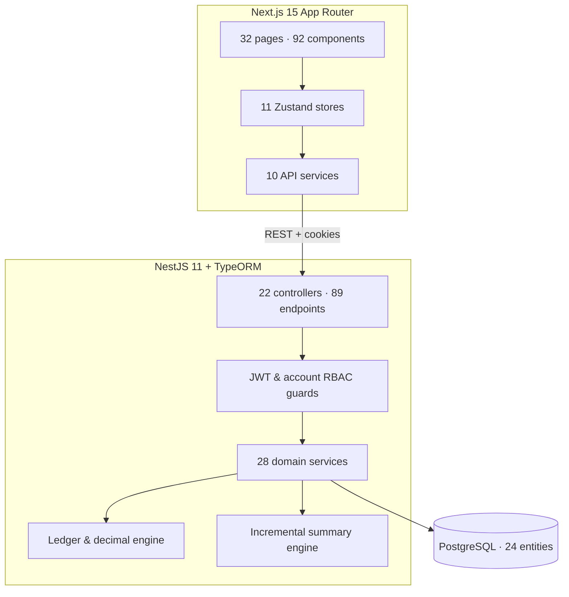

## System Architecture & Domain Scope

**MindVault** is a multi-user personal finance platform I built solo as a self-directed learning project, to practice production-style backend and frontend architecture rather than to serve live users. The NestJS backend owns accounts, transactions, the ledger, summaries, tags and authentication; the Next.js client handles dashboards, reports and account management.

| Layer | Flow |
|---|---|
| Frontend | `Page (app/)` → `Zustand Store` → `API Service` → HTTP |
| Backend | `Controller` → `ValidationPipe (DTO)` → `Service` → `TypeORM` → `PostgreSQL` |

### Persona Value Map

| Persona | Pains removed | Built |
|---|---|---|
| **Account Owner** | Balance drift, untraceable edits | Decimal ledger, immutable `AccountLedger`, non-negative checks |
| **Collaborator** | All-or-nothing sharing | Per-account roles via `AccountUserRole` and guards |
| **Dashboard Viewer** | Slow analytics, lost records | Pre-aggregated summaries, charts, soft-delete recycle bin |

## Core Engineering Innovations

### 1. Precision Ledger Engine
Balances are updated through `safeAdd` and `safeSubtract` helpers on `decimal.js`, with non-negative checks, while every change is written to an immutable `AccountLedger` table for audit.

### 2. Incremental Summary Pipeline
Transaction create, update and delete hooks update 6 summary entities (daily, weekly, monthly, yearly, category) in the same transaction, so analytics endpoints read rollups instead of raw history.

### 3. Contextual Account RBAC
An `AccountUserRole` junction entity maps users to accounts with Owner, Admin, Editor or Viewer roles, enforced by custom NestJS guards independent of global JWT auth.

### 4. Client State Architecture
Domain-specific Zustand stores and API services feed an `ApiResponseToast` listener, giving consistent success and error feedback across all mutations.

## Database Design & Concurrency

- 24 TypeORM entities on PostgreSQL covering users, sessions, accounts, ledgers, transactions, summaries, categories, currencies, roles and tags.
- Summary updates run in the same transaction as the ledger mutation they derive from, keeping balances and rollups consistent.
- Six `nestjs-command` seeders bootstrap roles, categories, currencies, account types, tag groups and tags.
- Tags use soft delete with restore, plus dedicated repositories, validators and transformers.

## Performance Benchmarks & Reliability

| Metric | Value |
|---|---|
| REST endpoints | 89 across 22 controllers |
| Domain services | 28 |
| Database entities | 24 |
| DTOs | 44 |
| Automated tests | 82 cases across 10 spec files |
| Frontend routes / components | 32 pages / 92 components |
| Zustand stores / API services | 11 / 10 |
| Commits | 161 (100 backend, 61 frontend), solo |

<!-- TODO(me): add real benchmarks if you measure them: dashboard endpoint latency with N transactions, summary update time per write. No latency numbers are claimed here. -->

## Lessons Learned & Architectural Retrospective

- **What worked:** isolating money math in one helper module and routing every balance change through it kept precision rules in a single place.
- **Trade-offs:** pre-aggregated summaries speed up reads but add write-path work; per-account roles add joins on scoped requests.
- **Learning outcome:** this project was my practice ground for modular NestJS design, transactional consistency, role-based access and a store-per-domain frontend.
- **Next:** statement export (PDF and CSV), then the personal growth suite.
<!-- TODO(me): add one or two honest "what I would do differently" points from your own experience. -->
